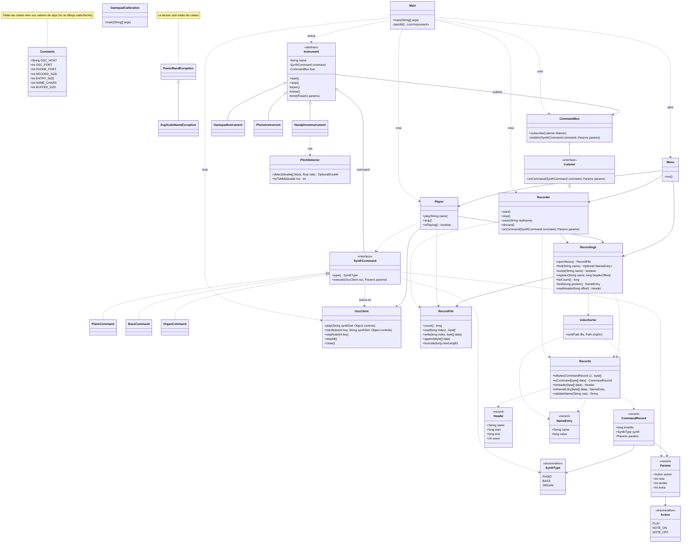

# Power Band

Programa en Java en el que **tres dispositivos físicos** tocan **tres sintetizadores de SuperCollider**, y un **editor musical** muestra los comandos en vivo, los graba, los guarda en archivos binarios y los reproduce idénticos a como se tocaron.

| Dispositivo | Sintetizador | Cómo se toca |
|---|---|---|
| Control de PlayStation | `classicPiano` (acorde) | Botones = nota de la escala, L1 = acorde menor, stick = octava |
| Celular Android | `organ70s` (suena hasta soltar) | Tocar la pantalla = nota; inclinar = nota y timbre |
| Micrófono de los audífonos | `stringBass` | Tararear una nota = nota de bajo |

## Requisitos

- JDK 21 o superior y Maven 3.9 o superior.
- [SuperCollider](https://supercollider.github.io/) (con su IDE).
- Un control de PlayStation (USB o Bluetooth), un celular **Android** con la app de `PowerBandPhone/` y unos audífonos con micrófono.
- La librería externa **JInput** (declarada en `pom.xml`, junto con sus librerías nativas) para leer el control. Java no trae una API estándar para controles de juego.

## Cómo ejecutar

1. Abrir `supercollider/myband.sc` en SuperCollider. Evaluar el bloque entre paréntesis (`Ctrl+Enter`, o `Cmd+Enter` en Mac) y luego la línea `~myband.load;`. Eso enciende el servidor y carga los tres synths.
2. Conectar los dispositivos (ver sección *Instrumentos*).
3. En la carpeta del proyecto:

   ```
   mvn clean package
   java "-Djava.library.path=target/natives" -jar target/power-band.jar
   ```

   `mvn package` también copia JInput a `target/lib/` y sus librerías nativas a `target/natives/`.
4. Al arrancar, el programa conecta con SuperCollider, activa los instrumentos (avisa cuáles quedaron activos y cuáles no, y sigue con los demás) y abre el menú del editor.

Menú del editor:

| Opción | Qué hace |
|---|---|
| 1 | Inicia la grabación |
| 2 | Detiene la grabación y pide un nombre (vacío = descartar; si está repetido, lo vuelve a pedir) |
| 3 | Lista las músicas en orden cronológico y reproduce la elegida |
| 4 | Detiene la reproducción |
| 5 | Activa o desactiva el monitor de comandos |
| 0 | Sale |

Las grabaciones se guardan en la carpeta `data/`.

**Herramienta de diagnóstico del control:** `powerband.instrument.GamepadCalibration` lista los dispositivos que ve JInput y muestra el número de cada botón o eje que se mueve. Sirve para ajustar los botones en `Constants`.

## Estructura del proyecto

```
src/main/java/powerband/
├── Main.java        # arranque: conecta SuperCollider, activa instrumentos, abre el editor
├── constants/       # constantes del proyecto
├── exception/       # PowerBandException y DuplicateNameException
├── instrument/      # abstracción del Bridge: Instrument y los tres dispositivos
├── command/         # implementación del Bridge: SynthCommand y CommandBus
├── synth/           # OscClient: mensajes OSC por UDP a SuperCollider
├── model/           # Params, CommandRecord, Header, NameEntry, Action, SynthType
├── repository/      # archivos binarios de tamaño fijo y búsqueda binaria
├── sort/            # Balanced Merge Sort externo
├── service/         # Recorder y Player
└── ui/              # Menu de consola
src/test/java/       # pruebas JUnit 5
supercollider/       # myband.sc (los synths)
PowerBandPhone/      # proyecto Android Studio de la app del celular
specs/               # specs de spec driven development
.github/             # reglas, instrucciones y atajos de Copilot
```

## Diseño (UML)

Un solo diagrama con todas las clases del proyecto y sus relaciones.



**Explicación del diagrama**

- **Bridge:** `Instrument` (qué dispositivo se toca) guarda un `SynthCommand` (qué synth suena). Se agrega un dispositivo o un synth sin tocar la otra jerarquía. `Main` es el único que decide qué dispositivo toca qué synth.
- **Observer:** todo comando pasa por el `CommandBus`. Quien hace sonar, el monitor y el `Recorder` son suscriptores. Ningún instrumento le habla a SuperCollider directo.
- **Persistencia:** `Recordings` maneja los tres archivos; `RecordFile` lee y escribe registros de tamaño fijo; `Records` convierte entre objetos y bytes; `IndexSorter` ordena el índice.

**Flujo de grabar**

1. Un instrumento publica el comando en el `CommandBus`.
2. El bus lo ejecuta en SuperCollider (suena), lo muestra en el monitor y se lo pasa al `Recorder`.
3. Si se está grabando, el `Recorder` escribe el registro con su tiempo relativo al inicio.
4. Al detener, se pide el nombre: se valida (1 a 12 caracteres, único), se completa el encabezado, se agrega la entrada a `recordings.list` y a `recordings.index`, y se ordena el índice.

**Flujo de reproducir**

1. El `Menu` lista las músicas desde `recordings.list` (orden cronológico) y el usuario elige una.
2. El `Player` busca el nombre con búsqueda binaria en el índice y lee el encabezado.
3. Un hilo lector pasa los comandos del disco a una cola (buffering).
4. Un hilo reproductor ejecuta cada comando en la hora `inicio + tiempo relativo`.

## Instrumentos

| Instrumento | Dispositivo | Entrada | Salida (parámetros del synth) |
|---|---|---|---|
| `GamepadInstrument` | Control de PlayStation, leído con JInput cada 10 ms | Botones 0–7, botón 10 (menor), eje `y` | Piano: nota de la escala de Do mayor desde la nota 48, ±12 por octava, tercera mayor o menor, 1500 ms. Solo dispara al **presionar**, no al mantener. |
| `PhoneInstrument` | Celular Android, por UDP al puerto **9000** | Texto `x;y;z;toque` | Órgano: `toque` = 1 enciende y 0 apaga la misma nota; `x` elige la nota (escala de 15 grados) y `y` el timbre (3 timbres). |
| `HeadphoneInstrument` | Micrófono de los audífonos (`javax.sound.sampled`) | Audio mono de 16 bits, bloques de 64 ms | Bajo: el volumen que sube tras un silencio dispara la nota; el tono (autocorrelación en `PitchDetector`) decide la nota, plegada al rango 28–55. |

El editor actúa como **servidor** del instrumento externo: `PhoneInstrument` escucha el puerto UDP en su propio hilo.

**Conexión de cada dispositivo**

- **Control:** por cable USB o Bluetooth, como cualquier control. JInput lo lee del sistema operativo.
- **Celular:** por Wi-Fi, sin cable. La computadora y el celular deben estar en la misma red (o el celular comparte su punto de acceso). En la app se escribe la IP de la computadora. El firewall debe permitir UDP en el puerto 9000.
- **Audífonos:** se conectan como entrada de micrófono del sistema. Se puede elegir el micrófono con `-Dpowerband.mic=parte-del-nombre`.

**App del celular (`PowerBandPhone/`):** proyecto de Android Studio (Java, paquete `cr.powerband.phone`) con el permiso `INTERNET` en el manifest. Se abre en Android Studio y se ejecuta en un celular Android con la depuración USB activada. Solo funciona en Android. En la app se escribe la IP de la computadora, se presiona *Conectar* y se mantiene el dedo en la pantalla para tocar.

## Archivos y algoritmos

Todo en binario, con registros de **tamaño fijo** (`RandomAccessFile` y `ByteBuffer`; no se usa `ObjectOutputStream` porque no garantiza tamaño fijo). Los nombres miden 12 caracteres (2 bytes c/u), rellenados con espacios.

| Archivo | Registro | Contenido |
|---|---|---|
| `recordings.music` | 48 bytes | **Encabezado**: tipo (1) + relleno (3) + nombre (24) + inicio (8) + fin (8) + cantidad (4). **Comando**: tipo (1) + synth (1) + acción (1) + relleno (1) + tiempo relativo en ms (8) + nota (4) + duración (4) + extra (4) + relleno hasta 48. |
| `recordings.index` | 32 bytes | Nombre (24) + posición del encabezado en `recordings.music` (8). Ordenado por nombre. |
| `recordings.list` | 32 bytes | Nombre (24) + fecha y hora en ms (8). Orden cronológico. |

**Encabezado.** El nombre se pide al terminar de grabar, pero el encabezado va antes de los comandos. Por eso se escribe un encabezado vacío al empezar, se graban los comandos en tiempo real y al guardar se vuelve atrás (`seek`) a completarlo.

**Búsqueda binaria en disco** (`Recordings.find`). Se hace `seek` al registro del medio del índice, se lee solo ese registro y se compara el nombre. Nunca se carga el índice. Sirve para validar nombres únicos y para cargar una música.

**Balanced Merge Sort externo** (`IndexSorter`). Se ejecuta al guardar cada grabación, sobre archivos, con cuatro temporales (`sort-a` a `sort-d`, en `data/tmp`):

1. **Distribución:** el índice se reparte registro por registro, alternando entre los archivos A y B (corridas de longitud 1).
2. **Mezcla:** se mezclan las corridas de A y B en C y D, alternando salidas. Solo hay en memoria los dos registros que se comparan. La longitud de la corrida se duplica.
3. Los archivos intercambian roles y se repite hasta que queda una sola corrida, que reemplaza a `recordings.index`.

**Reproducción fiel.** Un hilo lector pasa los comandos del disco a una cola de 64 (buffering). Un hilo reproductor espera a la hora absoluta `inicio + tiempo relativo` con `System.nanoTime()`, en lugar de sumar `sleep`s, para que no se acumule el desfase.

## Pruebas

```
mvn clean test
```

Son 19 tests de JUnit 5:

| Clase | Qué cubre |
|---|---|
| `StorageTest` | Tamaño fijo de los registros, validación de nombres, Balanced Merge Sort con archivos de muchos tamaños y búsqueda binaria. |
| `RecordingFlowTest` | Grabar, guardar, cargar y reproducir con los mismos intervalos (tolerancia de 60 ms), nombre repetido, descartar y reproducción doble. |
| `InstrumentsTest` | Detector de tono, bajo, control (flancos, menor, octava) y celular (noteOn/noteOff y mensajes inválidos). |
| `MainTest` | Mensaje de arranque. |

## Decisiones e interpretaciones del enunciado

- **Serialización:** escritura binaria manual con `ByteBuffer`, porque la serialización estándar de Java no garantiza tamaño fijo.
- **Mismo tamaño para encabezado y comandos:** los dos miden 48 bytes.
- **`noteOff` del órgano:** se graba como un comando propio.
- **Nombres:** de 1 a 12 caracteres y únicos sin distinguir mayúsculas.
- **Lo reproducido** va directo a SuperCollider y no pasa por el grabador, para que no se vuelva a grabar. Por eso el monitor no muestra comandos durante la reproducción.
- **Librería externa:** JInput, para leer el control de PlayStation.
- **Micrófono como dispositivo:** se usa el micrófono de los audífonos como instrumento del bajo.

## Proceso con IA

El desarrollo siguió spec driven development con GitHub Copilot en VS Code:

- Las reglas del proyecto están en `.github/copilot-instructions.md` y `.github/instructions/`.
- Los atajos `/generate-feature-spec`, `/develop-feature` y `/update-current-development` están en `.github/prompts/`.
- Las specs de cada feature están en `specs/` (por capa: `backend`, `database`, `frontend`, `testing` y `deploy`).
