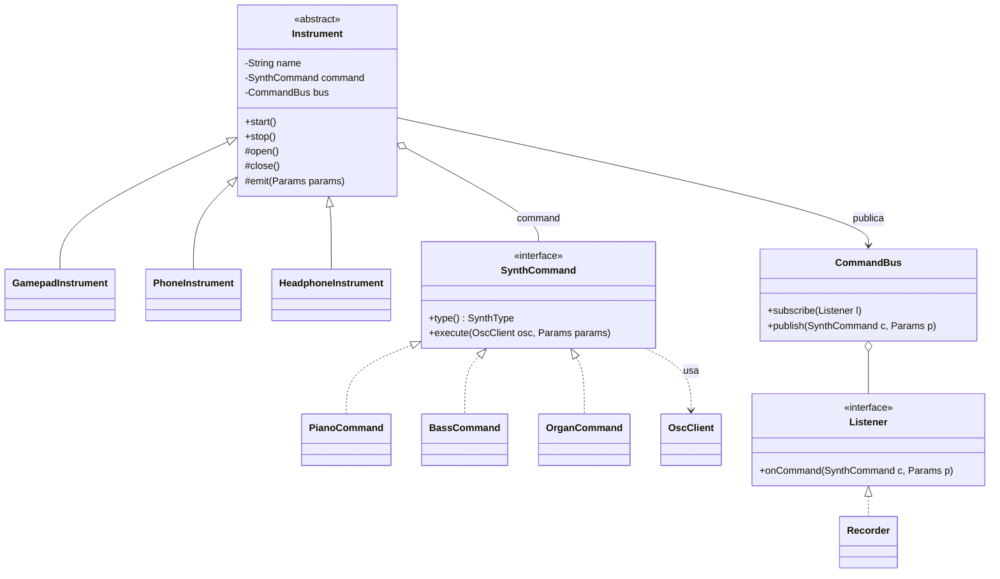
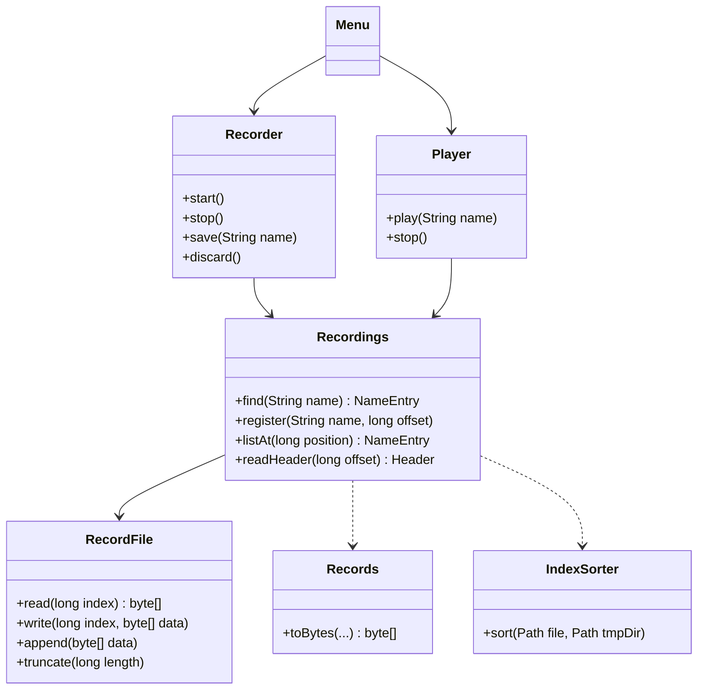
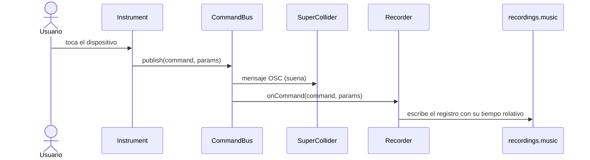
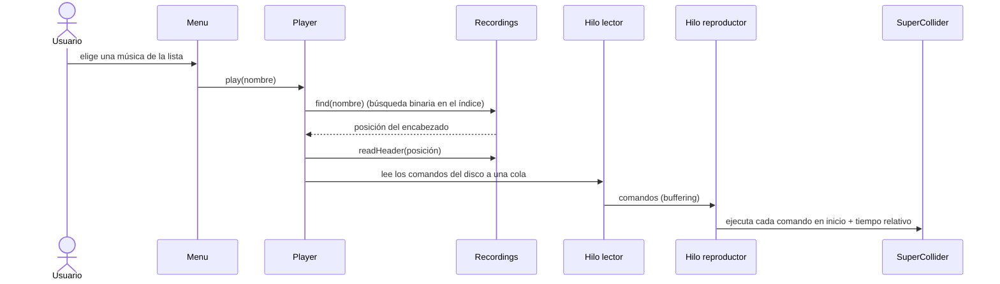

# Power Band

Programa en Java en el que tres dispositivos físicos tocan tres sintetizadores de SuperCollider, y un editor musical muestra los comandos en vivo, los graba, los guarda en archivos binarios y los reproduce idénticos a como se tocaron.

| Dispositivo | Sintetizador | Cómo se toca |
|---|---|---|
| Control de PlayStation | `classicPiano` (acorde) | Botones = nota de la escala, L1 = acorde menor, stick = octava |
| Celular Android | `organ70s` (suena hasta soltar) | Tocar la pantalla = nota; inclinar = nota y timbre |
| Micrófono de los audífonos | `stringBass` | Tararear una nota = nota de bajo |

## Cómo ejecutar

1. Abrir `supercollider/myband.sc` en SuperCollider. Evaluar el bloque entre paréntesis (`Ctrl+Enter`, o `Cmd+Enter` en Mac) y luego la línea `~myband.load;`. Eso enciende el servidor y carga los tres synths.
2. Conectar los dispositivos.
3. En la carpeta del proyecto:

   ```
   mvn clean package
   java -jar target/power-band.jar
   ```
4. Al arrancar, el programa conecta con SuperCollider, activa los instrumentos y abre el menú del editor.

Menú del editor:

| Opción | Qué hace |
|---|---|
| 1 | Inicia la grabación |
| 2 | Detiene la grabación y pide un nombre (vacío = descartar; si está repetido, lo vuelve a pedir) |
| 3 | Lista las músicas en orden cronológico y reproduce la elegida |
| 4 | Detiene la reproducción |
| 5 | Activa o desactiva el monitor de comandos |
| 0 | Sale |

Las grabaciones se guardan en la carpeta `data/`

## Estructura del proyecto

```
src/main/java/powerband/
├── Main.java        # arranque: conecta SuperCollider, activa instrumentos, abre el editor
├── constants/       # biblioteca de constantes (ningún valor quemado fuera de aquí)
├── exception/       # PowerBandException y DuplicateNameException
├── instrument/      # abstracción del Bridge: Instrument y los tres dispositivos
├── command/         # implementación del Bridge: SynthCommand y CommandBus
├── synth/           # OscClient: mensajes OSC por UDP a SuperCollider
├── model/           # Params, CommandRecord, Header, NameEntry, Action, SynthType
├── repository/      # archivos binarios de tamaño fijo y búsqueda binaria
├── sort/            # Balanced Merge Sort externo
├── service/         # Recorder y Player
└── ui/              # Menu de consola
supercollider/       # myband.sc (los synths)
android-app/         # app del celular
specs/               # specs de spec driven development
.github/             # reglas e instrucciones de Copilot
```

## Diseño

### Patrón Bridge y bus de comandos

El **Instrument** (abstracción, qué dispositivo se toca) guarda un **SynthCommand** (implementación, qué synth suena). Se puede agregar un dispositivo o un synth sin tocar la otra jerarquía. Todos los comandos pasan por el **CommandBus** (Observer): quien hace sonar, el monitor y el grabador son suscriptores.



### Almacenamiento y editor



### Grabar



Al terminar, el usuario pone el nombre: se valida (1 a 12 caracteres, único), se completa el encabezado, se agrega la entrada a `recordings.list` y a `recordings.index`, y se ordena el índice.

### Reproducir



## Instrumentos

| Instrumento | Dispositivo | Entrada | Salida (parámetros del synth) |
|---|---|---|---|
| `GamepadInstrument` | Control de PlayStation, leído con JInput cada 10 ms | Botones 0–7, botón 10 (menor), eje `y` | Piano: nota de la escala de Do mayor desde la nota 48, ±12 por octava, tercera mayor o menor, 1500 ms. Solo dispara al **presionar**, no al mantener. |
| `PhoneInstrument` | Celular Android, por UDP al puerto **9000** | Texto `x;y;z;toque` | Órgano: `toque` = 1 enciende y 0 apaga la misma nota; `x` elige la nota (escala de 15 grados) y `y` el timbre (3 timbres). |
| `HeadphoneInstrument` | Micrófono de los audífonos (`javax.sound.sampled`) | Audio mono de 16 bits, bloques de 64 ms | Bajo: el volumen que sube tras un silencio dispara la nota; el tono (autocorrelación en `PitchDetector`) decide la nota, plegada al rango 28–55. |

El editor actúa como **servidor** del instrumento externo: `PhoneInstrument` escucha el puerto UDP en su propio hilo. Si un dispositivo falla al arrancar, el programa avisa y sigue con los demás.

La app del celular está en `android-app/`. (pendiente) Pasos para compilarla e instalarla.

## Archivos y algoritmos

Todo en binario, con registros de **tamaño fijo** (`RandomAccessFile` y `ByteBuffer`; no se usa `ObjectOutputStream` porque no garantiza tamaño fijo). Los nombres miden 12 caracteres (2 bytes c/u), rellenados con espacios.

| Archivo | Registro | Contenido |
|---|---|---|
| `recordings.music` | 48 bytes | **Encabezado**: tipo (1) + relleno (3) + nombre (24) + inicio (8) + fin (8) + cantidad (4). **Comando**: tipo (1) + synth (1) + acción (1) + relleno (1) + tiempo relativo en ms (8) + nota (4) + duración (4) + extra (4) + relleno hasta 48. |
| `recordings.index` | 32 bytes | Nombre (24) + posición del encabezado en `recordings.music` (8). Ordenado por nombre. |
| `recordings.list` | 32 bytes | Nombre (24) + fecha y hora en ms (8). Orden cronológico. |

**Encabezado.** El nombre se pide al terminar de grabar, pero el encabezado va antes de los comandos. Por eso se escribe un encabezado vacío al empezar, se graban los comandos en tiempo real y al guardar se vuelve atrás (`seek`) a completarlo.

**Búsqueda binaria en disco** (`Recordings.find`). Se hace `seek` al registro del medio del índice, se lee solo ese registro y se compara el nombre. Nunca se carga el índice. Sirve para validar nombres únicos y para cargar una música.

**Balanced Merge Sort externo** (`IndexSorter`). Se ejecuta al guardar cada grabación, sobre archivos, con cuatro temporales (`sort-a` a `sort-d`, en `data/tmp`):

1. **Distribución:** el índice se reparte registro por registro, alternando entre los archivos A y B (corridas de longitud 1).
2. **Mezcla:** se mezclan las corridas de A y B en C y D, alternando salidas. Solo hay en memoria los dos registros que se comparan. La longitud de la corrida se duplica.
3. Los archivos intercambian roles y se repite hasta que queda una sola corrida, que reemplaza a `recordings.index`.

**Reproducción fiel.** Un hilo lector pasa los comandos del disco a una cola de 64 (buffering). Un hilo reproductor espera a la hora absoluta `inicio + tiempo relativo` con `System.nanoTime()`, en lugar de sumar `sleep`s, para que no se acumule el desfase.

## Pruebas

```
mvn clean test
```

Son 19 tests de JUnit 5

| Clase | Qué cubre |
|---|---|
| `StorageTest` | Tamaño fijo de los registros, validación de nombres, Balanced Merge Sort con archivos de muchos tamaños y búsqueda binaria. |
| `RecordingFlowTest` | Grabar, guardar, cargar y reproducir con los mismos intervalos (tolerancia de 60 ms), nombre repetido, descartar y reproducción doble. |
| `InstrumentsTest` | Detector de tono, bajo, control (flancos, menor, octava) y celular (noteOn/noteOff y mensajes inválidos). |
| `MainTest` | Mensaje de arranque. |

## Proceso con IA

El desarrollo siguió spec driven development con GitHub Copilot en VS Code:

- Las reglas del proyecto están en `.github/copilot-instructions.md` y `.github/instructions/`.
- Los atajos `/generate-feature-spec`, `/develop-feature` y `/update-current-development` están en `.github/prompts/`.
- Las specs de cada feature están en `specs/`.
