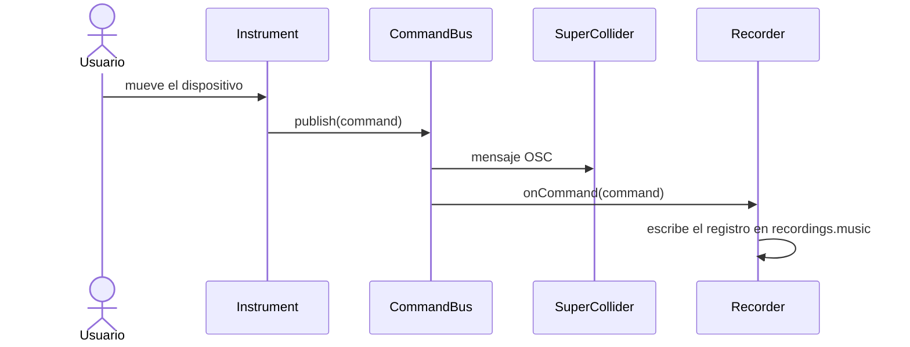
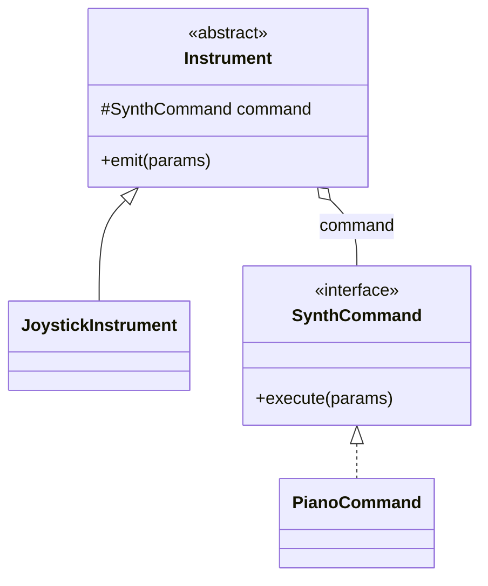

# Fase 0 – Preparación: guía paso a paso

> Proyecto: **Caso #3 – Power Band**. Último commit: **miércoles 18 de noviembre de 2026**.
> Esta guía es para **las dos**. Cada paso dice **qué se hace, cómo se hace y para qué sirve**.
> Los pasos marcados **[Ambas]** los hace cada una en su computadora. Los marcados **[Tú]** o **[Compañera]** los hace solo una.

---

## 0. Resumen

**Objetivo de la fase:** que las dos tengan el mismo ambiente funcionando (Java, Maven, Git, VS Code con Copilot, SuperCollider), un repositorio compartido en GitHub con el esqueleto del proyecto, las reglas de Copilot adaptadas, una forma de trabajar acordada y la cita con el profesor solicitada.

**Al terminar tendrán:**

- Las dos oyen los synths sonar desde Java.
- `mvn clean test` y `mvn package` funcionan en las dos computadoras.
- Un repo privado en GitHub con commits de ambas.
- Reglas y prompts de Copilot revisados y ajustados a mano (esto se evalúa).
- Un acuerdo de equipo escrito.
- El correo al profesor enviado.

| # | Paso | Quién | Tiempo aprox. |
|---|---|---|---|
| 1 | Instalar herramientas | Ambas | 30–45 min |
| 2 | VS Code, extensiones y Copilot | Ambas | 15 min |
| 3 | SuperCollider y prueba de sonido | Ambas | 20–30 min |
| 4 | Probar Java → SuperCollider con `BandClient` | Ambas | 10 min |
| 5 | Crear el repositorio en GitHub | Tú | 10 min |
| 6 | Subir el esqueleto | Tú | 10 min |
| 7 | Clonar el repositorio | Compañera | 5 min |
| 8 | Verificar que compila y corre | Ambas | 10 min |
| 9 | Ejercicio de calentamiento con Git (rama, PR, revisión) | Ambas | 30 min |
| 10 | Revisar y ajustar las reglas de Copilot | Ambas | 30–45 min |
| 11 | Escribir al profesor | Tú (o ambas) | 15 min |
| 12 | Acuerdos del equipo | Ambas | 20 min |

Total: una tarde. Si dividen bien, se puede hacer en dos sesiones cortas.

---

## 1. Qué trae el zip `power-band-esqueleto.zip`

```
power-band/
├── pom.xml                      # Build de Maven (Java 21, JUnit 5, jar con Main)
├── README.md                    # Esqueleto con las secciones finales (se llena en la Fase 9)
├── .gitignore                   # Qué no se sube (target/, .idea/, data/, ...)
├── .gitattributes               # Marca *.music, *.index, *.list como binarios
├── .vscode/extensions.json      # Extensiones recomendadas (VS Code las sugiere al abrir)
├── .github/
│   ├── copilot-instructions.md  # Reglas generales del proyecto para Copilot
│   ├── instructions/            # Reglas por tema y "skills" de spec driven development
│   └── prompts/                 # Atajos /generate-feature-spec, /develop-feature, /update-current-development
├── specs/                       # Aquí se guardan las specs (frontend, backend, database, testing, deploy)
├── supercollider/myband.sc      # Los synths del profesor
├── reference/BandClient.java.txt# Cliente OSC de ejemplo (solo referencia, no compila con el proyecto)
├── docs/plan-general.md         # El plan completo del proyecto
└── src/
    ├── main/java/powerband/
    │   ├── Main.java            # Punto de entrada (por ahora solo imprime un mensaje)
    │   └── constants, exception, instrument, command, synth,
    │       model, repository, sort, service, network, ui   # un paquete por responsabilidad
    └── test/java/powerband/MainTest.java
```

**Por qué existe cada cosa:**

- `pom.xml`: sin él no hay compilación ni tests con Maven, y las reglas de Copilot lo asumen.
- Los paquetes ya creados reflejan el diseño (Bridge, archivos binarios, merge sort), así que cada feature futura cae en un lugar claro.
- `.gitattributes` evita que Git altere los bytes de los archivos binarios de grabaciones (en Windows, por ejemplo, podría convertir saltos de línea y corromperlos).
- `.github/` es lo que Copilot lee automáticamente para seguir las reglas del curso.

> **Importante:** el esqueleto lo armé yo fuera de su computadora y **no pude ejecutar Maven allá** (mi ambiente no lo tiene). El paso 8 es justamente para comprobarlo. Si algo falla, copien el mensaje de error y me lo mandan.

---

## 2. Los pasos

### Paso 1 – Instalar herramientas **[Ambas]**

**Qué:** instalar JDK, Maven y Git.

**Cómo:**

1. **JDK 21** (recomendado, LTS). Cualquier distribución sirve (Temurin, Oracle, etc.).
2. **Maven** (3.9 o superior). Descargarlo, descomprimirlo y agregar su carpeta `bin` al `PATH`.
3. **Git**.
4. Verificar en una terminal nueva:

   ```
   java -version
   javac -version
   mvn -v
   git --version
   ```

   Los cuatro comandos deben responder con una versión. `javac -version` es importante: si no existe, instalaron solo el JRE y no el JDK.
5. Configurar Git (con **el mismo correo que usan en GitHub**):

   ```
   git config --global user.name "Tu Nombre"
   git config --global user.email "tu-correo@ejemplo.com"
   git config --global init.defaultBranch main
   ```

**Para qué sirve:**

- El JDK compila y ejecuta el proyecto; Maven ejecuta compilación, tests y empaquetado con un solo comando.
- El correo de Git tiene que coincidir con el de su cuenta de GitHub: si no, **los commits no aparecen como suyos** y se pierde la evidencia de que contribuyeron (se pueden restar hasta 25 puntos por no contribuir).

**Si tienen una versión distinta de Java:** si tienen 17, funciona; cambien `maven.compiler.release` en `pom.xml` a `17` (paso 8). Las dos deben usar el **mismo** número.

---

### Paso 2 – VS Code, extensiones y Copilot **[Ambas]**

**Qué:** dejar VS Code listo para Java y para que Copilot siga las reglas del repositorio.

**Cómo:**

1. Instalar VS Code.
2. Instalar estas extensiones (al abrir el repo, VS Code las sugiere gracias a `.vscode/extensions.json`):
   - **Extension Pack for Java** (`vscjava.vscode-java-pack`)
   - **GitHub Copilot** y **GitHub Copilot Chat**
   - **Markdown Preview Mermaid Support** (`bierner.markdown-mermaid`) para ver los diagramas UML
   - **GitLens** (opcional, ayuda a ver quién cambió cada línea)
3. Iniciar sesión con la cuenta de GitHub que tiene Copilot.
4. Abrir el panel de Copilot Chat y comprobar que responde. Cambiar el modo a **Agent** (el selector está junto al cuadro de texto): las skills del proyecto necesitan que Copilot pueda crear y editar archivos.
5. En *Settings*, buscar `instruction files` y confirmar que el uso de archivos de instrucciones está activado (suele estarlo por defecto).

**Para qué sirve:** Copilot lee `.github/copilot-instructions.md` y `.github/instructions/*.md` y los usa como reglas. Si esa opción está apagada, Copilot ignora las reglas del proyecto y genera código con otro estilo.

---

### Paso 3 – SuperCollider y prueba de sonido **[Ambas]**

**Qué:** instalar SuperCollider, cargar los synths y oírlos.

**Cómo:**

1. Instalar SuperCollider (incluye el IDE `scide`).
2. Abrir `supercollider/myband.sc` (o el original del zip del profesor).
3. Hacer clic **dentro del bloque grande entre paréntesis** y presionar `Ctrl+Enter` (en Mac, `Cmd+Enter`). Eso define los synths y las funciones.
4. Ir al final del archivo, a la línea `~myband.load;`, ponerse en esa línea y `Ctrl+Enter`. Esto **enciende el servidor** y carga los synths. En la ventana *Post* debe aparecer algo como `myband: classicPiano, stringBass, organ70s loaded`.
5. En la línea `~myband.test;` presionar `Ctrl+Enter`: debe sonar una demo corta de los tres instrumentos.
6. Probar a mano, una línea a la vez:

   ```
   ~myband.piano(48, 2000);
   ~myband.piano(57, 2000, 3);
   ~myband.bass(36, 800);
   ~myband.noteOn(60);
   ~myband.noteOff(60);
   ```

   `noteOn` deja sonando el órgano hasta que se hace `noteOff` con la misma nota.

**Para qué sirve:** **todo el sonido del proyecto depende de esto.** Java no genera audio: manda mensajes a este servidor. Tienen que repetir el paso 4 (`~myband.load;`) **cada vez** que abran SuperCollider para trabajar.

**Si algo falla:**

| Síntoma | Qué hacer |
|---|---|
| No suena nada pero el servidor arranca | Revisar el dispositivo de audio de salida del sistema; en SuperCollider, menú *Server* → *Reboot Server*. |
| `Server not running` | Falta ejecutar `~myband.load;`. |
| Las notas quedan sonando | `Ctrl+.` (en Mac `Cmd+.`) detiene todos los sonidos. |
| El servidor no arranca | Cerrar otras instancias de SuperCollider y reintentar; permitir SuperCollider en el firewall. |

---

### Paso 4 – Probar Java → SuperCollider con `BandClient` **[Ambas]**

**Qué:** confirmar que un programa Java puede hacer sonar los synths por UDP.

**Cómo:**

1. Con el servidor **ya cargado** (paso 3), copiar el `BandClient.java` original (el del zip del profesor, o `reference/BandClient.java.txt` renombrado a `BandClient.java`) a una carpeta temporal fuera del repositorio.
2. En esa carpeta ejecutar:

   ```
   java BandClient.java
   ```

   (Java 11 o superior puede correr un archivo suelto sin compilarlo aparte.)
3. Deben oír: acordes de piano, notas de bajo y notas de órgano.

**Para qué sirve:** valida el camino completo `Java → UDP (puerto 57110) → scsynth → sonido` en **las dos** computadoras antes de diseñar nada. Si falla aquí, es un tema de ambiente y no de código del proyecto. Además el `BandClient` es la base que van a refactorizar en la feature de comandos.

**No lo copien tal cual al repo:** está en el paquete por defecto y tiene valores quemados. Por eso quedó como `.txt` en `reference/`.

---

### Paso 5 – Crear el repositorio en GitHub **[Tú]**

**Qué:** el repositorio donde queda registrado todo el trabajo.

**Cómo:**

1. En GitHub: *New repository*.
2. Nombre sugerido: `power-band`. Visibilidad: **Private**.
3. **No** marcar "Add a README", ni `.gitignore`, ni licencia (el esqueleto ya los trae; si no, el primer push tendría conflicto).
4. *Settings → Collaborators → Add people*: agregar a tu compañera por su usuario. Ella acepta la invitación (le llega por correo y en GitHub).
5. Preguntar al profesor si debe agregarse como colaborador y con qué usuario (paso 11).

**Para qué sirve:** el enunciado exige que todo el trabajo quede en GitHub y el profesor revisa los commits de cada una. Un repo privado evita que otros copien el código.

---

### Paso 6 – Subir el esqueleto **[Tú]**

**Qué:** el primer commit del proyecto.

**Cómo:**

1. Descomprimir `power-band-esqueleto.zip`; queda la carpeta `power-band`.
2. En una terminal dentro de esa carpeta:

   ```
   git init -b main
   git add .
   git status
   git commit -m "chore: esqueleto inicial del proyecto"
   git remote add origin https://github.com/TU-USUARIO/power-band.git
   git push -u origin main
   ```

**Qué hace cada comando:**

| Comando | Para qué |
|---|---|
| `git init -b main` | Convierte la carpeta en un repositorio con la rama `main`. |
| `git add .` | Prepara todos los archivos para el commit. |
| `git status` | **Revisar** que no se haya colado nada raro (por ejemplo `target/`). |
| `git commit -m "..."` | Guarda la foto del proyecto con un mensaje. |
| `git remote add origin URL` | Conecta la carpeta con el repo de GitHub. |
| `git push -u origin main` | Sube y deja `main` enlazada con `origin/main`. |

Si GitHub pide autenticación, usen el inicio de sesión desde el navegador que ofrece VS Code/Git, o un token personal.

---

### Paso 7 – Clonar el repositorio **[Compañera]**

**Cómo:**

```
git clone https://github.com/USUARIO-DE-QUIEN-CREO-EL-REPO/power-band.git
cd power-band
code .
```

(Usa la URL que aparece en el botón verde *Code* del repo.) VS Code pregunta si confía en la carpeta: sí. Debe sugerir instalar las extensiones recomendadas.

**Verificar:** `git log --oneline` debe mostrar el commit "chore: esqueleto inicial del proyecto".

**Para qué sirve:** `clone` descarga el repo completo con su historial y deja el `origin` ya configurado.

---

### Paso 8 – Verificar que compila y corre **[Ambas]**

**Qué:** comprobar que el esqueleto funciona en las dos máquinas.

**Cómo (desde la carpeta del proyecto):**

```
mvn clean test
mvn package
java -jar target/power-band.jar
```

**Resultado esperado:**

- `mvn clean test`: termina con `BUILD SUCCESS` y `Tests run: 1, Failures: 0`.
- `mvn package`: crea `target/power-band.jar`.
- `java -jar target/power-band.jar`: imprime `Power Band: project skeleton is ready`.

**Si falla:**

| Error | Causa probable | Solución |
|---|---|---|
| `invalid target release: 21` / `release version 21 not supported` | JDK más viejo que 21 | Cambiar `maven.compiler.release` en `pom.xml` al número de su JDK (el mismo para las dos) y hacer commit. |
| `mvn: command not found` | Maven fuera del `PATH` | Revisar paso 1 y abrir una terminal nueva. |
| No descarga dependencias | Sin internet o proxy | Reintentar con internet; Maven descarga JUnit la primera vez. |
| `No compiler is provided in this environment` | Tienen JRE, no JDK | Instalar JDK y revisar `JAVA_HOME`. |

**Para qué sirve:** si en este punto algo falla, es mucho más barato corregirlo hoy que a mitad de una feature. Si hacen un cambio al `pom.xml`, ese cambio es el primer commit "de equipo" del proyecto.

---

### Paso 9 – Ejercicio de calentamiento con Git **[Ambas]**

**Qué:** practicar el flujo completo (rama → commit → push → pull request → revisión → merge) con un cambio inofensivo. Sirve de práctica real y además deja commits de **las dos** desde el principio.

**Cómo (cada una, con su propia rama):**

1. Actualizar `main`:

   ```
   git switch main
   git pull
   ```
2. Crear la rama:

   ```
   git switch -c setup/tu-nombre
   ```
3. Editar `README.md` y completar **tu línea** en la sección *Equipo* (nombre y usuario de GitHub).
4. Commit y push:

   ```
   git add README.md
   git commit -m "docs(readme): agrega integrante al equipo"
   git push -u origin setup/tu-nombre
   ```
5. En GitHub, abrir el **Pull Request** hacia `main`.
6. **La otra persona revisa** el PR (pestaña *Files changed*), deja al menos un comentario y lo aprueba.
7. Hacer el merge desde GitHub con **"Create a merge commit"** (conserva los commits de cada autora).
8. Las dos: `git switch main && git pull`.

**Pista del conflicto:** como las dos editan el mismo archivo y el mismo bloque, la segunda en hacer merge probablemente verá un **conflicto**. Resuélvanlo juntas (VS Code muestra *Accept current / incoming / both*): es exactamente lo que pasará en el proyecto y es parte de lo que el profesor evalúa en Git.

**Para qué sirve:** el flujo de trabajo del proyecto va a ser siempre este. Mejor equivocarse aquí con un README que con código del merge sort.

---

### Paso 10 – Revisar y ajustar las reglas de Copilot **[Ambas]**

**Qué:** entender, revisar y modificar **a mano** los archivos de `.github/`.

**Por qué es importante:** el enunciado dice que se revisan las **modificaciones manuales** que hagan a las reglas y specs después de que la IA las generó. Yo adapté el `devsetup` del profesor a este proyecto; ahora ustedes lo leen, lo entienden y lo ajustan, y eso debe quedar visible en commits propios.

**Qué hay y para qué sirve cada archivo:**

| Archivo | Qué hace | Cuándo lo usa Copilot |
|---|---|---|
| `.github/copilot-instructions.md` | Stack, paquetes, mapeo de roles y las reglas que no se pueden romper (Bridge, `CommandBus`, binario de tamaño fijo, sin arreglos en memoria). | Siempre. |
| `.github/instructions/java-conventions...` | Convenciones de código. | Al editar archivos `.java`. |
| `.github/instructions/testing-junit...` | Convenciones de tests JUnit 5. | Al editar tests. |
| `.github/instructions/frontend / backend / database / testing / deploy ...` | Mapas de cada capa; se refrescan solos con `update-current-development`. | Según el archivo que se edite. |
| `.github/instructions/generate-feature-spec...` | Convierte una descripción de feature en **specs** `draft`. | Cuando se usa el prompt `/generate-feature-spec`. |
| `.github/instructions/develop-feature...` | Implementa una feature **solo si todas sus specs están `approved`**; corre los tests y **no arregla fallas**. | Cuando se usa `/develop-feature`. |
| `.github/instructions/update-current-development...` | Escanea el código y actualiza los mapas de capa; hace commit de `.github/instructions/` sin hacer push. | Cuando se usa `/update-current-development`. |
| `.github/prompts/*.prompt.md` | Atajos para invocar lo anterior escribiendo `/` en el chat. | Al escribir `/` en Copilot Chat. |

**Qué adapté yo respecto al original del profesor:**

- `copilot-instructions.md` y `java-conventions`: paquetes de Power Band (`instrument`, `command`, `synth`, `repository`, `sort`…) en lugar de `model/service/repository/dto`.
- Mapeo de roles: *database* = archivos binarios (`repository` y `sort`), *backend* = instrumentos y comandos, *frontend* = `ui`.
- Reglas del proyecto: Bridge, `CommandBus`, binario de tamaño fijo, prohibido cargar grabaciones en arreglos, tiempos absolutos de reproducción, thread-safety.
- `generate-feature-spec`: se cambió la lista que define qué carpetas son *frontend/backend/database*.
- Mapas de capa iniciales, y los tres prompts (`.prompt.md`), que son un agregado mío para que se invoquen con `/`.

**Qué tienen que hacer ustedes (a mano):**

1. Leer **todos** los archivos de `.github/` completos. Si no entienden una regla, pregunten (a mí o al profesor).
2. Decidir y editar lo que les corresponda como equipo. Por ejemplo: el nombre del paquete base (`powerband`), la versión de Java, si el código y los comentarios van en inglés o español, o cualquier regla que no les convenza.
3. Hacer commits **separados** y con mensajes que lo digan:

   ```
   docs(rules): reglas adaptadas por IA para Power Band
   docs(rules): ajuste manual - <qué cambiaron y por qué>
   ```

   (El primero ya está en el commit inicial; los ajustes van después.)
4. Probar que Copilot **sí está usando** las reglas: abrir el chat en modo Agent, escribir `/` y comprobar que aparecen los tres prompts. Después de una respuesta, expandir la lista de referencias usadas y comprobar que incluye `copilot-instructions.md`.

**Si `/` no muestra los prompts:** abran el archivo de instrucciones y adjúntenlo al chat (botón de clip o `#file`) y pídanle seguirlo. El resultado es el mismo, solo cambia cómo lo invocan.

---

### Paso 11 – Escribir al profesor **[Tú o ambas]**

**Qué:** resolver las dudas que condicionan el diseño y pedir la cita de revisión.

**Cómo:** enviar este correo (ajústenlo):

> **Asunto:** Caso #3 Power Band – consultas de diseño y solicitud de cita
>
> Profesor,
>
> Somos [nombres] y estamos trabajando el Caso #3 en pareja. Antes de fijar el diseño quisiéramos confirmar lo siguiente:
>
> 1. **Hardware:** ¿puede facilitarnos algún dispositivo (sensor, microcontrolador, joystick)? ¿La pantalla táctil o el trackpad de la laptop cuentan como "superficie táctil" o se consideran mouse?
> 2. **Archivos:** el enunciado menciona "Serialization". Como la serialización estándar de Java no da registros de tamaño fijo, pensamos usar `RandomAccessFile` / `DataOutputStream` con campos de ancho fijo. ¿Está bien?
> 3. **Tamaño de registro:** ¿el encabezado de cada grabación debe medir lo mismo que los registros de comandos?
> 4. **Balanced Merge Sort:** ¿esperan el esquema de dos archivos de entrada y dos de salida, con corridas iniciales de un registro?
> 5. **Librerías:** para leer un joystick o un puerto serial necesitaríamos una librería externa. ¿Se permite si la justificamos?
> 6. **Comandos:** el `noteOff` del órgano lo grabamos como un comando propio. ¿Está bien?
> 7. **GitHub:** ¿debemos agregarlo como colaborador del repositorio? ¿Con qué usuario?
>
> Además, quisiéramos agendar la **cita de revisión** para la semana del 16 de noviembre.
>
> Saludos,
> [nombres]

**Para qué sirve:** las preguntas 2, 3 y 4 cambian el formato de los archivos y el algoritmo; mejor saberlo **antes** de escribir las specs. Y la cita se llena rápido: pedirla ya.

---

### Paso 12 – Acuerdos del equipo **[Ambas]**

**Qué:** 20 minutos para decidir cómo van a trabajar y dejarlo por escrito (en `docs/acuerdos.md` o en un mensaje fijado).

**Decidan:**

| Tema | Propuesta | Su decisión |
|---|---|---|
| Reunión de sincronización | 2–3 veces por semana, 20–30 min | |
| Canal de comunicación | Un chat de WhatsApp/Discord | |
| Reparto inicial | A: instrumentos, comandos y dispositivos. B: archivos, merge sort, grabador y reproductor. | |
| Quién revisa a quién | Toda PR la revisa la otra persona | |
| Rama por feature | `ft-N-nombre-corto` | |
| Mensajes de commit | `tipo(ámbito): resumen` (`feat`, `fix`, `docs`, `test`, `chore`, `refactor`) | |
| Cuándo se mergea | Con PR aprobada y `mvn test` en verde | |
| Idioma del código | Identificadores en inglés; documentación en español | |
| Versión de Java | La misma para las dos | |
| Sesiones de explicación cruzada | Cada feature mergeada se la explica quien la hizo a la otra | |

**Para qué sirve:** el enunciado puede restar puntos a quien no entienda o no haya contribuido. Estos acuerdos evitan que una persona cargue todo y que la otra no pueda defender el código.

---

## 3. La fase 0 está terminada cuando…

- [ ] Las dos corrieron `~myband.load;` y oyeron los synths
- [ ] Las dos corrieron `java BandClient.java` y oyeron el piano, el bajo y el órgano
- [ ] `mvn clean test` da `BUILD SUCCESS` en las dos máquinas
- [ ] `java -jar target/power-band.jar` imprime el mensaje de arranque
- [ ] El repo está en GitHub, privado, con las dos como colaboradoras
- [ ] Las dos hicieron un PR y el de la otra fue mergeado
- [ ] Copilot en modo Agent muestra los prompts `/generate-feature-spec`, `/develop-feature` y `/update-current-development`
- [ ] Leyeron y ajustaron las reglas de `.github/` con commits manuales
- [ ] Se envió el correo al profesor
- [ ] Hay un acuerdo de equipo escrito

---

## 4. Qué sigue: Fase 1 (diseño y specs)

1. Reunirse con las respuestas del profesor (o con las propuestas por defecto si todavía no contesta).
2. Elegir los **tres dispositivos**.
3. Hacer el **UML del Bridge** y definir el **formato en bytes** de los registros (propuesta en `docs/plan-general.md`, sección 6).
4. Generar las specs con `/generate-feature-spec`, **revisarlas, editarlas y aprobarlas ustedes**.

Cambio respecto al plan general: como el esqueleto ya se creó a mano en esta fase, **`ft-1` ya no es el esqueleto**. Pasa a ser: **constantes y excepciones base**.

---

## Apéndice A – Ciclo de trabajo con Copilot (desde la Fase 1)

Para **cada feature**:

1. Abrir Copilot Chat en modo **Agent**.
2. Escribir `/generate-feature-spec` y describir la feature. Copilot crea archivos en `specs/<capa>/ft-N-nombre.md` con `status: draft`.
3. **Revisar y editar** cada spec a mano. Si Copilot inventó algo que no calza con el enunciado, corregirlo.
4. Cambiar a mano `status: draft` a `status: approved` en el encabezado de **cada** archivo de la feature. Copilot no lo hace por ustedes, y `develop-feature` no implementa nada que no esté aprobado.
5. Escribir `/develop-feature` e indicar el id (por ejemplo `ft-2`). Copilot implementa en este orden: database, backend, frontend, testing, deploy.
6. Revisar el código **línea por línea** (tienen que poder defenderlo) y correr `mvn test`. Si un test falla, `develop-feature` no lo arregla: lo piden aparte.
7. Escribir `/update-current-development` para refrescar los mapas de `.github/instructions/`. Hace commit solo de esa carpeta.
8. Commit del código en la rama de la feature, push y PR; la otra persona revisa.

Commits separados siempre que se pueda: uno para lo generado por IA y otro para los ajustes manuales.

---

## Apéndice B – README final y UML en Mermaid

**Meta:** README sencillo pero completo. Se va llenando durante el proyecto (el UML nace en la Fase 1, no al final) y se cierra en la Fase 9.

### B.1 Estructura final (10 secciones)

| Sección | Qué lleva | Extensión |
|---|---|---|
| **Título y descripción** | Qué es Power Band, en 2–3 líneas. | Corta |
| **Equipo** | Nombres y usuarios de GitHub. | 2 líneas |
| **Requisitos** | JDK, Maven, SuperCollider y los dispositivos usados. | Lista corta |
| **Cómo ejecutar** | Pasos: abrir SuperCollider y `~myband.load;`, `mvn package`, `java -jar target/power-band.jar`, cómo conectar los dispositivos. | Numerada |
| **Estructura del proyecto** | Árbol de paquetes con una línea por paquete. | Bloque de código |
| **Diseño (UML)** | Diagramas en Mermaid (ver B.2). | 3–4 diagramas |
| **Instrumentos** | Tabla: dispositivo → synth → cómo se convierte en parámetros. | Tabla |
| **Archivos y algoritmos** | Formato de los tres archivos, búsqueda binaria y Balanced Merge Sort en pocas líneas. | Tablas + texto breve |
| **Pruebas** | Cómo correr `mvn test` y qué cubren. | Corta |
| **Decisiones e interpretaciones** | Lo que se interpretó del enunciado y se validó con el profesor; el proceso con IA (specs y reglas). | Lista |

Regla simple: **cada sección responde una pregunta** y nada se explica dos veces. Si algo ocupa más de una pantalla, va a `docs/` y el README lo enlaza.

### B.2 Diagramas UML en Mermaid

GitHub dibuja los bloques ` ```mermaid ` directamente en el README. En VS Code se ven con la extensión *Markdown Preview Mermaid Support*.

| Diagrama | Tipo de Mermaid | Qué muestra |
|---|---|---|
| **Bridge** (obligatorio) | `classDiagram` | `Instrument` y sus hijos ↔ `SynthCommand` y sus hijos. |
| **Clases por paquete** | `classDiagram` | Servicios, repositorios, `CommandBus`, listeners. |
| **Grabar** | `sequenceDiagram` | Instrumento → bus → SuperCollider y grabador → archivo. |
| **Reproducir** | `sequenceDiagram` | Reproductor lee archivo → cola → bus → SuperCollider. |
| **Archivos** (opcional) | `flowchart` o tabla | Relación entre `.music`, `.index` y `.list`. |

**Ejemplo de diagrama de secuencia (grabar):**

````

````

**Ejemplo de diagrama de clases (Bridge):**

````

````

**Consejos para que se vean bien:**

- Máximo 12–15 elementos por diagrama; si hay más, partir en dos.
- Mostrar solo los métodos que explican el diseño, no todos.
- Probar el diagrama en la vista previa de VS Code **antes** de hacer commit: un error de sintaxis hace que GitHub muestre un recuadro rojo en vez del dibujo.
- Mantener el UML actualizado cuando cambie el diseño (revisarlo al cerrar cada feature).

### B.3 Plantilla para copiar

El `README.md` del esqueleto ya trae las secciones con marcas `(pendiente)`. Al llenarlas, borren la marca. Cuando no quede ningún `(pendiente)`, el README está completo.

---

## Apéndice C – Comandos de Git que van a usar todo el tiempo

| Necesito… | Comando |
|---|---|
| Ver qué cambió | `git status`, `git diff` |
| Traer lo último | `git switch main` → `git pull` |
| Crear rama de feature | `git switch -c ft-2-comandos` |
| Guardar cambios | `git add <archivos>` → `git commit -m "feat(command): ..."` |
| Subir la rama | `git push -u origin ft-2-comandos` (la primera vez) o `git push` |
| Ver historial | `git log --oneline --graph --all` |
| Ver quién cambió una línea | `git blame <archivo>` (o GitLens) |
| Guardar trabajo a medias | `git stash` / `git stash pop` |
| Deshacer un commit ya compartido | `git revert <hash>` |
| Traer `main` a mi rama | `git switch mi-rama` → `git merge main` |
