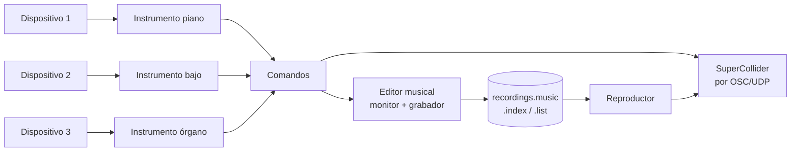
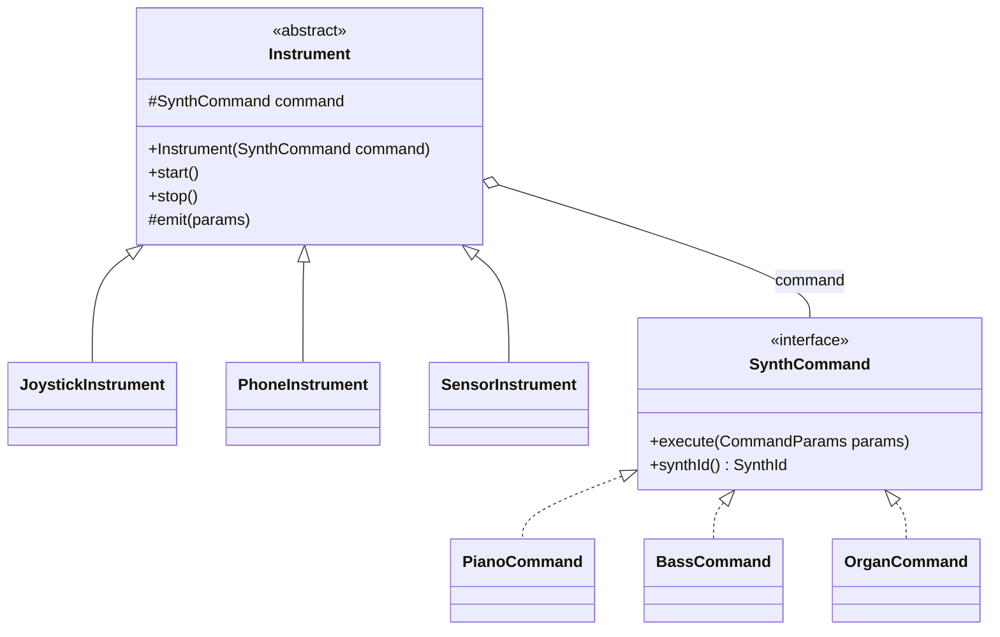
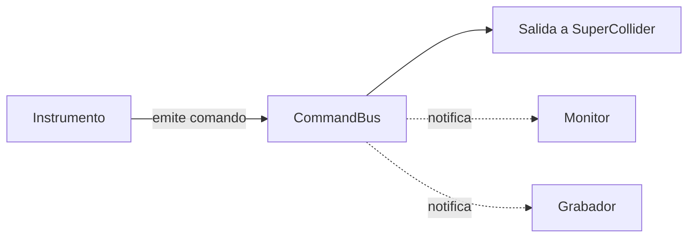
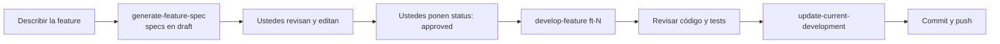

# Caso #3 – Power Band: guía completa del proyecto

> Documento de trabajo para la pareja. Resume el enunciado (`Caso #3.md`), los archivos técnicos (`myband.sc`, `BandClient.java`), el ambiente de desarrollo con IA (`devsetup`) y las notas de patrones (Week #10–#12).
> Todo lo marcado como **propuesta** es una sugerencia de diseño, no un requisito del profesor.
> **Último commit: miércoles 18 de noviembre de 2026.** Valor: 20 %.

---

## 1. Qué hay que construir

Power Band es un programa en **Java** que crea, guarda y reproduce música. Tiene tres partes:

| Parte | Qué es | Quién lo da |
|---|---|---|
| **Sintetizadores** | Generan el sonido. Viven en SuperCollider. | El profesor (`myband.sc`), se pueden modificar. |
| **Instrumentos** | Dispositivos físicos conectados a Java que controlan los synths. | Ustedes. |
| **Editor musical** | Monitorea, graba, almacena y reproduce la música. | Ustedes. |

Flujo general:



---

## 2. Los materiales del zip

### 2.1 `myband.sc` (SuperCollider)

Define tres `SynthDef`:

| Synth | Parámetros | Comportamiento |
|---|---|---|
| `classicPiano` | `note` (MIDI), `durMs`, `third` (4 = mayor, 3 = menor), `amp` | Acorde de 4 notas (raíz, tercera, quinta, octava). Suena `durMs` y se apaga solo. |
| `stringBass` | `note`, `durMs`, `amp` | Nota pulsada (Karplus-Strong). Suena `durMs` y se apaga solo. |
| `organ70s` | `freq`, `amp`, `gate`, `r1 r2 r3`, `a1 a2 a3`, vibrato, `atk`, `rel` | Tres parciales (razones y amplitudes). **Suena hasta que `gate = 0`** (noteOff). |

Uso: abrir el archivo en el IDE de SuperCollider, evaluar el bloque entre paréntesis y luego `~myband.load;` (arranca el servidor y carga los synths). `~myband.test;` toca una demo.

**Importante:** cada vez que quieran probar el programa, SuperCollider tiene que estar abierto con el servidor encendido y los synths cargados.

### 2.2 `BandClient.java`

Cliente OSC mínimo, sin librerías, que habla **directo con `scsynth`** por UDP (host `127.0.0.1`, puerto `57110`) usando `/s_new` y `/n_set`.

- `playPiano(note, durMs, major)`, `playBass(note, durMs)`, `noteOn(note, ratios, amps)`, `noteOff(note)`, `allNotesOff()`.
- Maneja los ids de nodo y las notas de órgano activas.
- Codifica OSC a mano (enteros, flotantes, strings).

Sirve de **guía**. Para el proyecto hay que refactorizarlo: está en el paquete por defecto, tiene valores quemados (puerto, ids, `4`/`3` de la tercera, nombres de synths) y no calza con el patrón Bridge ni con las reglas de constantes.

### 2.3 `devsetup/`

Reglas y skills para tres herramientas de IA, con el mismo contenido:

| Carpeta | Herramienta |
|---|---|
| `.claude/` | Claude Code (`rules/` y `skills/`) |
| `.cursor/` | Cursor (`rules/` y `skills/`) |
| `.github/` | GitHub Copilot (`copilot-instructions.md` e `instructions/`) |

Usen la que corresponda a su herramienta. Detalles en la sección 8.

### 2.4 Notas de clase (Week #10, #11, #12)

- **Week #10:** Singleton, Abstract Factory, Builder.
- **Week #11:** Adapter, Decorator, Facade, Proxy y **Bridge** (el obligatorio).
- **Week #12:** Strategy, Observer, Iterator, Visitor, Mediator, Memento, State, Chain of Responsibility.

---

## 3. Requisitos del enunciado, uno por uno

### 3.1 Instrumentos

- Programa en Java al que se conectan los instrumentos.
- Los dispositivos emiten valores que ustedes transforman en parámetros de los synths.
- **No pueden ser teclado ni mouse.** Sí: superficies táctiles, joysticks, sensores, termómetros, y el acelerómetro, giroscopio o cámara del celular.
- Celular: hay que hacer una **app Android** (no se recomienda iOS).
- No comprar hardware. Consultar primero al profesor, que puede facilitar alguno.
- **Un dispositivo distinto por sintetizador**: 3 dispositivos, 3 synths, todos usables en cualquier momento.
- Al iniciar el programa: se activan los instrumentos, se conecta con SuperCollider y se accede al editor.

### 3.2 Editor musical

- Puede ser parte del mismo programa. Si **al menos un instrumento es externo** (app Android), el editor también debe poder **recibir mensajes** (actuar como servidor).
- Conoce en todo momento los comandos que los instrumentos mandan a SuperCollider.
- Graba, reproduce y carga música.

### 3.3 Grabar

- Con el modo grabación activo, **todos los comandos y sus tiempos** se guardan en un archivo en tiempo real.
- Al desactivarlo se pide un **nombre** para la música.
- Cada grabación tiene un **encabezado**: nombre, punto de inicio y punto de terminación dentro de `recordings.music`.

### 3.4 Archivos

| Archivo | Contenido |
|---|---|
| `recordings.music` | Todas las grabaciones, una tras otra, cada una con su encabezado y sus comandos. |
| `recordings.index` | Índice de las músicas, **ordenado por nombre**. |
| `recordings.list` | Solo nombre y fecha/hora de cada grabación, en orden cronológico. |

Reglas:

- Búsqueda en `recordings.index` con **búsqueda binaria en disco**.
- Registros de **tamaño fijo** en `recordings.music` y `recordings.index`, con **escritura binaria**.
- Ordenar el índice con **Balanced Merge Sort** (ordenación externa).
- **Prohibido** ordenar o recorrer arreglos en memoria para los recordings indexados: todo ocurre en el almacenamiento físico.

### 3.5 Cargar y reproducir

1. **Cargar** muestra las canciones en orden cronológico (de `recordings.list`).
2. El usuario elige una; con su nombre se hace la **búsqueda binaria** en el índice y se obtiene el encabezado.
3. **Play**: proceso de *buffering* que pasa al reproductor los comandos "en tiempo y forma". Tiene que sonar **idéntico** a como se grabó.

### 3.6 Precisiones de la sección "Otros aspectos"

- **Registros de `recordings.music`:** encabezado seguido de los comandos. Cada comando guarda como mínimo el instante (relativo al inicio de la grabación), el synth y sus parámetros. **Todos los registros tienen el mismo tamaño fijo.**
- **Registros de `recordings.index`:** nombre (longitud fija) y posición del encabezado en `recordings.music`.
- **Nombres únicos:** si ya existe, se rechaza y se pide otro.
- **Indexación:** al terminar **cada** grabación se actualiza el índice con Balanced Merge Sort sobre archivos.
- **Orden cronológico** en `recordings.list`.
- **Fidelidad:** se respetan los intervalos grabados entre comandos, sin depender de cuándo se cargó la música.
- **Bridge:** jerarquía de instrumentos (abstracción) separada de la jerarquía de comandos a los synths (implementación).
- Si interpretan algo distinto, **justifíquenlo en la especificación y valídenlo con el profesor.**

### 3.7 Calidad, evaluación y proceso

- Encapsulamiento, separación de responsabilidades, **ningún valor quemado** (biblioteca de constantes), uso intensivo de herencia y polimorfismo.
- Java. Individual o en pareja (ustedes: pareja).
- Se permite cualquier IA, pero hay que **entender, explicar y defender** el código, el diseño de clases y los algoritmos, y dar cuenta de **cualquier línea**. Penalización: **30 a 70 puntos**.
- Se evalúan los patrones de diseño, **especialmente Bridge**.
- Se espera dominio de excepciones, `InputStream`/`OutputStream` y sus clases padre/hijas, y **excepciones personalizadas**.
- Se espera ambiente configurado para IA y la versión resumida de **spec driven development**.
- Se revisan las **modificaciones manuales** que hagan a reglas y specs después de que la IA las generó, y los commands y specs generados por IA.
- Revisión en **cita programada**. Todo el trabajo registrado en **GitHub**.
  - Si un estudiante no contribuyó al código: hasta **-25**.
  - No dominar GitHub y la línea de comandos: hasta **-15**.

---

## 4. Puntos ambiguos para consultar con el profesor

Conviene llevar esta lista a la primera consulta:

1. **Hardware:** ¿qué dispositivos puede facilitar? ¿Un trackpad o la pantalla táctil de la laptop cuenta como "superficie táctil" o se confunde con el mouse?
2. **"Serialization":** el enunciado la menciona entre paréntesis, pero la serialización estándar de Java (`ObjectOutputStream`) **no garantiza registros de tamaño fijo**. Propuesta: `RandomAccessFile` o `DataOutputStream` con campos de ancho fijo. ¿Está bien?
3. **Tamaño del encabezado:** "todos los registros tienen el mismo tamaño fijo". ¿Eso incluye el encabezado de cada grabación? (Propuesta: sí, mismo tamaño, con relleno.)
4. **Balanced Merge Sort:** ¿se espera el esquema clásico de dos archivos de entrada y dos de salida, con corridas iniciales de 1 registro?
5. **Librerías:** las reglas piden preferir la biblioteca estándar. Para leer un joystick o un puerto serial hace falta una librería externa. ¿Se permite si se justifica?
6. **Contenido de los comandos:** si un instrumento manda el comando de apagado del órgano (`noteOff`), ¿se graba como comando propio? (Propuesta: sí.)

---

## 5. Diseño propuesto

### 5.1 El Bridge

Las dos dimensiones que varían de forma independiente son **qué dispositivo/instrumento lo controla** y **qué synth se invoca**.



- **Abstracción:** `Instrument` y sus hijos (según el dispositivo). Leen el dispositivo y convierten los valores crudos en parámetros musicales.
- **Implementación:** `SynthCommand` y sus hijos (según el synth). Saben cómo invocar su synth.
- Un instrumento nuevo o un synth nuevo se agrega **sin tocar la otra jerarquía** (esa es la defensa del patrón).

### 5.2 Un solo punto por donde pasan los comandos

Para que el editor "conozca en todo momento los comandos", **todo comando pasa por un despachador central**:



- Patrón sugerido: **Observer** (monitor y grabador se suscriben al bus) o **Mediator**.
- El grabador solo escribe si el modo grabación está activo.
- En la **reproducción**, los comandos decodificados del archivo van a la salida de SuperCollider **sin** pasar por el grabador (para no regrabar lo que se reproduce).

### 5.3 Otros patrones que encajan (opcionales, pero suman)

| Patrón | Dónde |
|---|---|
| **Singleton** | Conexión a SuperCollider / configuración. |
| **Factory** | Crear el `SynthCommand` correcto a partir de un registro leído del archivo (decodificación). |
| **State** | Estado del editor: inactivo, grabando, reproduciendo. |
| **Facade** | Fachada del editor para la interfaz (grabar, cargar, reproducir). |
| **Iterator** | Recorrer los comandos de una grabación leyéndolos del disco. |

No es obligatorio usarlos todos. Úsenlos solo donde resuelven un problema real y que ambos puedan explicar.

### 5.4 Estructura de paquetes (propuesta)

Las reglas del `devsetup` asumen `model / service / repository / dto` y `Main.java` en `src/main/java/<paquete>/`. Hay que **adaptarlas** a algo como:

```
src/main/java/cr/.../powerband/
├── Main.java
├── constants/        # biblioteca de constantes (puerto, nombres de synths, tamaños, rutas...)
├── exception/        # excepciones propias (RecordingException, IndexCorruptedException, ...)
├── instrument/       # jerarquía de instrumentos (abstracción del Bridge)
├── command/          # jerarquía de comandos (implementación del Bridge) + CommandBus
├── synth/            # cliente OSC refactorizado de BandClient
├── model/            # CommandRecord, RecordingHeader, IndexEntry, ...
├── repository/       # archivos binarios: music, index, list; búsqueda binaria
├── sort/             # Balanced Merge Sort externo
├── service/          # grabador, reproductor, editor
├── network/          # servidor para instrumento externo (si aplica)
└── ui/               # monitor y menús (consola o Swing)
src/test/java/...     # JUnit 5, espejo de los paquetes
```

---

## 6. Formato de archivos (propuesta)

Todo en binario con campos de ancho fijo (`DataOutputStream` / `RandomAccessFile`). Los números concretos van en la biblioteca de constantes.

### 6.1 `recordings.music`

Registro de **64 bytes** (ejemplo), de dos tipos distinguidos por un byte inicial:

**Encabezado** (tipo 0):

| Campo | Tamaño | Nota |
|---|---|---|
| tipo | 1 | 0 = encabezado |
| relleno | 3 | |
| nombre | 32 | 16 caracteres con `writeChar` (2 bytes c/u), relleno con espacios |
| inicio | 8 | `long`, posición en bytes del primer comando |
| fin | 8 | `long`, posición en bytes del final de la grabación |
| relleno | 12 | para completar los 64 |

**Comando** (tipo 1):

| Campo | Tamaño | Nota |
|---|---|---|
| tipo | 1 | 1 = comando |
| synth | 1 | piano / bajo / órgano |
| acción | 1 | tocar / noteOn / noteOff |
| relleno | 1 | |
| tiempo | 8 | `long`, ms desde el inicio de la grabación |
| nota | 4 | MIDI |
| durMs | 4 | |
| third | 4 | 4 o 3 (piano) |
| r1, r2, r3 | 12 | `float` (órgano) |
| a1, a2, a3 | 12 | `float` (órgano) |
| relleno | 16 | para completar los 64 |

Un comando de bajo usa solo `nota` y `durMs`; el resto va en cero. Es el precio de tener registros de tamaño fijo.

### 6.2 `recordings.index`

| Campo | Tamaño |
|---|---|
| nombre | 32 (igual que el encabezado) |
| posición del encabezado en `recordings.music` | 8 |

Registro de 40 bytes, **ordenado por nombre**. La búsqueda binaria hace `seek(mitad * 40)`, lee el nombre y compara. Nunca se carga el archivo completo.

### 6.3 `recordings.list`

| Campo | Tamaño |
|---|---|
| nombre | 32 |
| fecha y hora (epoch en ms) | 8 |

Solo se agrega al final, por eso conserva el orden cronológico.

### 6.4 Truco para el encabezado

El nombre se pide **al terminar** de grabar, pero el encabezado va **antes** de los comandos. Solución:

1. Al activar la grabación se escribe un **encabezado vacío** (reserva el lugar) y se anota su posición.
2. Los comandos se escriben en tiempo real a continuación.
3. Al desactivar: se pide el nombre, se valida que sea único (búsqueda binaria en el índice) y, si es válido, se hace `seek` al encabezado y se completan nombre, inicio y fin.
4. Si el usuario cancela, se descarta la grabación (hay que decidir cómo: truncar el archivo es lo más limpio).
5. Se agrega la entrada a `recordings.list` y se actualiza el índice.

---

## 7. Algoritmos

### 7.1 Búsqueda binaria en disco

```
bajo = 0; alto = totalRegistros - 1
mientras bajo <= alto:
    medio = (bajo + alto) / 2
    archivo.seek(medio * TAMANIO_REGISTRO)
    nombreMedio = leerNombre()
    comparar con el buscado → devolver, subir o bajar
```

Se usa para **dos cosas**: validar nombre único y localizar una grabación al cargar.

### 7.2 Balanced Merge Sort externo

Se usan **cuatro archivos temporales** (A, B de entrada; C, D de salida), alternando roles en cada pasada:

1. **Distribución:** leer el índice registro por registro y repartirlo alternadamente en A y B (corridas de longitud 1).
2. **Mezcla:** tomar la primera corrida de A y la primera de B, mezclarlas (solo se tienen en memoria los dos registros que se comparan) y escribir el resultado en C; la siguiente pareja va a D; y así alternando. Las corridas ahora miden el doble.
3. **Intercambiar roles:** C y D pasan a ser entrada, A y B salida. Repetir.
4. **Fin:** cuando queda una sola corrida (una de las dos salidas queda vacía), ese archivo es el índice ordenado. Se reemplaza `recordings.index`.

Número de pasadas ≈ log₂(n). En cada una se lee y escribe secuencialmente, sin arreglos.

Detalle práctico: se puede agregar el registro nuevo al final del índice y ordenar; el enunciado pide aplicar Balanced Merge Sort al terminar cada grabación, y eso cumple (conviene confirmarlo con el profesor, punto 4 de la sección 4).

### 7.3 Reproducción fiel

- Un hilo lee los comandos de la grabación en bloques (el "buffering") y los pone en una cola.
- Otro hilo de reproducción calcula, para cada comando, `horaInicio + tiempoRelativo` y espera hasta esa hora **absoluta** (`System.nanoTime()`), en vez de sumar `sleep`s sucesivos, que acumulan desfase.
- Al terminar o cancelar: `allNotesOff()` para que no queden notas de órgano sonando.

### 7.4 Grabación en tiempo real

- Varios instrumentos emiten **en paralelo**, así que el grabador tiene que ser **thread-safe** (sincronizar la escritura o usar una cola con un solo hilo escritor).
- El tiempo de cada comando es `ahora - inicioGrabacion`.

---

## 8. Ambiente de desarrollo con IA (spec driven development)

### 8.1 Qué trae el `devsetup`

| Pieza | Para qué sirve |
|---|---|
| **Reglas** (`java-conventions`, `testing-junit`) | Convenciones: solo Java, `Main` en su lugar, paquetes en minúscula, clases `PascalCase`, constantes `UPPER_SNAKE_CASE`, un tipo público por archivo, depender de interfaces, JUnit 5. |
| **Skill `generate-feature-spec`** | Convierte una descripción de feature en specs cortas por capa dentro de `specs/`, siempre con `status: draft`. |
| **Skill `develop-feature`** | Implementa una feature **solo si todas sus specs están `approved`**, en orden: database, backend, frontend, testing, deploy. Corre los tests y **reporta sin arreglar fallas**. |
| **Skill `update-current-development`** | Escanea el código y escribe un mapa por capa (`.claude/skills/<capa>/references/map.md`) y lo commitea. |

Los "roles" se mapean así en este proyecto:

| Rol | En Power Band |
|---|---|
| frontend | Interfaz de consola o Swing (monitor, menús) |
| backend | Servicios, modelo, comandos, instrumentos |
| database | Persistencia en archivos binarios (repository, sort) |
| testing | JUnit 5 |
| deploy | `pom.xml` / `build.gradle`, jar, script para correr |

### 8.2 El ciclo de trabajo



### 8.3 Lo que hay que hacer a mano (y se evalúa)

1. **Crear `CLAUDE.md`** en la raíz del repo con el stack (versión de Java, Maven/Gradle, JUnit 5, SuperCollider/OSC) y las guías del proyecto. Las skills lo leen y **no viene en el zip**. (Si usan Copilot, el equivalente es `.github/copilot-instructions.md`, que sí viene.)
2. **Adaptar las reglas** a Power Band (nuevos paquetes, biblioteca de constantes obligatoria, excepciones propias, Bridge). Hacerlo en commits propios para que la revisión vea sus modificaciones manuales.
3. **Revisar y editar cada spec** que genere la IA antes de aprobarla. Dejar rastro de los cambios en Git.
4. **Aprobar ustedes** (`status: approved`). Las skills no lo hacen.
5. Si un test falla, `develop-feature` no lo arregla: lo piden ustedes aparte.
6. Corran `update-current-development` al terminar cada feature y commiteen el resultado.

### 8.4 Features propuestas para las specs

| Id | Feature |
|---|---|
| ft-1 | Esqueleto del proyecto, constantes y excepciones base |
| ft-2 | Conexión OSC a SuperCollider y comandos de synth (implementación del Bridge) |
| ft-3 | Instrumentos (abstracción del Bridge) con dispositivos simulados |
| ft-4 | `CommandBus` y monitor en vivo |
| ft-5 | Capa de archivos de registro fijo y búsqueda binaria |
| ft-6 | Balanced Merge Sort externo |
| ft-7 | Grabación e indexación |
| ft-8 | Cargar y reproducir |
| ft-9 | Dispositivos físicos reales (los tres) |
| ft-10 | Servidor para instrumento externo (solo si hay app Android) |
| ft-11 | Interfaz y flujo de arranque |

---

## 9. Los instrumentos: cómo decidir

Hay que elegir **tres dispositivos distintos**, uno por synth. Opciones del enunciado:

| Dispositivo | Valores que da | Observaciones |
|---|---|---|
| Celular (acelerómetro/giroscopio) | Ejes x, y, z | Requiere app Android y que el editor reciba mensajes por red. |
| Joystick / gamepad | Ejes y botones | Java no trae API estándar; probablemente necesite una librería. |
| Sensor con microcontrolador (Arduino, ESP) | Distancia, luz, temperatura, potenciómetro | Conexión serial o Wifi. Preguntar al profesor si lo presta. |
| Superficie táctil | Posición del toque | Confirmar que no se considera mouse. |

Ideas de mapeo (propuesta, ajústenlas a lo que consigan):

- **Piano:** un eje elige la nota, un botón elige mayor/menor (`third`).
- **Bajo:** un valor de sensor elige la nota; un evento (umbral, sacudida) dispara el golpe.
- **Órgano:** un dispositivo continuo; un eje cambia las razones y amplitudes de los parciales y el contacto hace `noteOn`/`noteOff`.

Criterio práctico: **elijan los más fáciles de conseguir y de conectar a Java**, porque el tiempo es corto y el valor del proyecto está en el Bridge, los archivos y el merge sort, no en el hardware exótico.

---

## 10. Plan de trabajo y fechas

Hoy es **31 de octubre**; el último commit es el **18 de noviembre** (18 días).

| Fechas aprox. | Fase | Entregable |
|---|---|---|
| 1–3 nov | **0. Preparación** | Repo en GitHub con ambos colaboradores, SuperCollider funcionando, `BandClient` sonando, proyecto Maven/Gradle, `CLAUDE.md` y reglas adaptadas, consulta al profesor, **cita de revisión solicitada**. |
| 3–5 nov | **1. Diseño y specs** | UML con Bridge, layout de bytes, decisión de los 3 dispositivos, specs ft-1…ft-11 revisadas y aprobadas. |
| 5–8 nov | **2. Núcleo del sonido** | Constantes, excepciones, comandos, instrumentos simulados, `CommandBus`, monitor. Se oyen los 3 synths desde Java. |
| 8–11 nov | **3 y 4. Persistencia y merge sort** | Archivos de registro fijo, búsqueda binaria, merge sort externo, con tests JUnit. |
| 11–14 nov | **5 y 6. Grabar, cargar y reproducir** | Ciclo completo con dispositivos simulados: grabar, nombrar, indexar, listar, reproducir idéntico. |
| 14–16 nov | **7 y 8. Dispositivos reales e interfaz** | Los tres instrumentos físicos integrados, servidor externo si aplica, menús y flujo de arranque. |
| 16–18 nov | **9. Cierre** | Auditoría de constantes, excepciones, README, `update-current-development`, ensayo de la defensa, commits finales. |

Si algo se atrasa, **recorten por abajo**: la interfaz bonita se sacrifica antes que el índice o el reproductor.

---

## 11. Reparto en pareja

| Persona A | Persona B |
|---|---|
| Instrumentos (Bridge, abstracción) | Persistencia: archivos, búsqueda binaria |
| Comandos y conexión a SuperCollider | Balanced Merge Sort |
| Dispositivos físicos y servidor externo | Grabador y reproductor |

**Contrato entre ambos:** la clase del registro de comando (qué campos tiene, cómo se codifica) y la interfaz del `CommandBus`. Se fija **juntos en la fase 1**; después cada uno trabaja en su rama.

Para no perder puntos:

- Cada quien tiene que **commitear código real** durante todo el desarrollo (no concentrar todo en una persona).
- Revisen los pull requests del otro y **explíquense el código** entre ustedes: en la cita, el profesor puede preguntar a cualquiera sobre cualquier línea.
- Antes de la cita, cada uno debe poder dibujar el diagrama del Bridge, explicar el merge sort paso a paso y justificar el formato de los registros.

---

## 12. Git y línea de comandos

Se evalúa, así que practíquenlo en serio desde el día 1:

- `clone`, `status`, `add`, `commit`, `push`, `pull`
- ramas: `branch`, `switch`/`checkout`, `merge` y resolución de conflictos
- `log` (con `--oneline --graph`), `diff`, `blame`, `stash`, `revert`
- `.gitignore` (excluir `target/`, `.idea/`, archivos `.music/.index/.list` de prueba)
- mensajes de commit claros y una rama por feature (`ft-5-binary-files`, etc.), con pull requests entre ustedes

---

## 13. Riesgos y cómo evitarlos

| Riesgo | Prevención |
|---|---|
| Nadie consigue el hardware a tiempo | Consultar al profesor **esta semana**; tener dispositivos simulados para avanzar mientras tanto. |
| Reproducción con desfase | Tiempos absolutos con `nanoTime`, no `sleep` acumulados; probarlo comparando contra la grabación. |
| Registros que no son de tamaño fijo | Un solo lugar (constantes + clase de codificación) define los tamaños; tests que verifiquen `longitud del archivo % tamaño == 0`. |
| Merge sort que usa memoria | Revisar que solo existan los registros que se comparan; sin `List`/arreglos con los recordings. |
| Valores quemados | Búsqueda de números y strings sueltos antes de la entrega (puerto, rutas, tamaños, rangos MIDI). |
| Notas de órgano que quedan sonando | `allNotesOff()` al detener, al cerrar y ante excepciones (`finally`). |
| Una persona no entiende el código | Sesiones de explicación cruzada y preguntas de práctica antes de la cita. |
| Perder el rastro de lo que cambió la IA | Commits separados para "generado por IA" y "ajustado a mano" en reglas y specs. |

---

## 14. Checklist final

- [ ] Los tres synths suenan desde Java por OSC
- [ ] Tres dispositivos distintos, ninguno teclado ni mouse, uno por synth
- [ ] Bridge: `Instrument` (abstracción) separado de `SynthCommand` (implementación)
- [ ] Editor ve todos los comandos en vivo
- [ ] Grabar: encabezado con nombre, inicio y fin; nombre único
- [ ] `recordings.music`, `.index` y `.list` en binario, registros de tamaño fijo
- [ ] Búsqueda binaria en disco (nombre único y cargar)
- [ ] Balanced Merge Sort externo tras **cada** grabación, sin arreglos en memoria
- [ ] Cargar lista en orden cronológico; play suena idéntico
- [ ] Servidor para instrumento externo, si aplica
- [ ] Constantes en una biblioteca, cero valores quemados
- [ ] Excepciones propias y manejo correcto de streams (`try-with-resources`)
- [ ] `CLAUDE.md`, reglas adaptadas, specs revisadas y aprobadas a mano
- [ ] Tests JUnit 5 de persistencia, búsqueda y merge sort
- [ ] README y UML
- [ ] Commits de ambos integrantes, último commit antes del 18 de noviembre
- [ ] Cita con el profesor agendada
